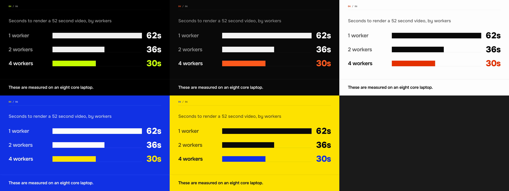

# scenefile

[](https://github.com/Xusniddin-devv/scenefile/actions/workflows/ci.yml)
[](https://www.npmjs.com/package/scenefile)

Turn a small JSON file into a video. Built so that any language model, including
ones that cannot see images, can produce a correct video and fix its own mistakes.

**Status: early development.** Twelve scene types (`title`, `statement`, `quote`,
`bullets`, `stat`, `chart`, `code`, `screenshot`, `compare`, `clip`, `outro`, `terminal`), ten
themes, screenshots captured from your own web app, narration in English and Russian made on your own machine, captions and a music
bed work today. Fonts are bundled, so Latin and
Cyrillic text is set in the same typefaces and layout on every machine (edges differ
slightly between operating systems); emoji use the machine's own emoji font.


Every frame above came from [`examples/tour.json`](examples/tour.json): 53 lines of JSON,
no drawing, narrated and captioned on the machine that rendered it.

## Install

You need Node 22 or newer and `ffmpeg` on your `PATH`. macOS and Linux are tested (CI
runs on Linux x64; development is on Apple silicon); Windows is untested.

```bash
npm install -g scenefile
scenefile setup      # downloads the browser it draws with (about 200 MB, once)
scenefile doctor     # says what, if anything, is still missing
```

On Linux, `scenefile setup --with-deps` also installs the system libraries the browser
needs.

## Try it

```bash
scenefile init                 # writes an example scenefile.json
scenefile check scenefile.json
scenefile render scenefile.json -o video.mp4
```

The video at the top of this page is [`examples/tour.json`](examples/tour.json). A
narrated render downloads its voice the first time (320 MB for the default voice, once). To work on scenefile
itself, see [CONTRIBUTING.md](CONTRIBUTING.md).

## A scenefile

```json
{
  "version": 1,
  "scenes": [
    { "type": "title", "heading": "Ship faster", "highlight": "faster", "sub": "A CLI for X" },
    { "type": "terminal", "steps": [{ "run": "npx x init", "output": "Done in 2s" }] }
  ]
}
```

Durations are worked out from how long the text takes to read, and text is sized to
fit. `check` measures the layout in a real browser and reports problems as text, each
with the path of the field and how to fix it:

```
error  TEXT_OVERFLOW  scenes[0].heading
  This text needs 4 lines at its smallest size; only 3 fit.
  fix: Shorten it to about 51 characters (it has 77).
```

```
error  SCHEMA_UNKNOWN_SCENE  scenes[0].type
  Unknown scene type "titel". Did you mean "title"?
  fix: "type" must be one of: title, statement, quote, bullets, stat, code, outro, screenshot, compare, chart, terminal.
```

## Use from an AI agent

Scenefile has no model of its own and needs none: the model in your coding terminal
reads your code and writes the scenefile, and scenefile checks and renders it. Nothing
is sent to a service and nothing costs money.

**Claude Code**, as a plugin (the skills and the MCP server in one step):

```
/plugin install scenefile --marketplace Xusniddin-devv/scenefile
```

On Claude Code older than 2.1.275, do it in two steps: `/plugin marketplace add
Xusniddin-devv/scenefile`, then `/plugin install scenefile@scenefile`. The first narrated
video downloads a 320 MB voice; `scenefile voices install en-emma` does that ahead of time
and shows its progress.

Then ask for what you want: "make a video explaining how auth works in this repo",
"make a walkthrough video of the app on localhost:3000", "make a release video for
v2.1". The plugin's recipes cover six kinds of video:

| Recipe | For |
|---|---|
| `scenefile-explain-code` | How a function, module or project works, with the real code on screen. |
| `scenefile-app-walkthrough` | A tour of a running web app, from real captures of its screens. |
| `scenefile-launch-video` | A short announcement of a project or feature. |
| `scenefile-changelog-video` | What changed in a release, from the changelog and commits. |
| `scenefile-edit-video` | Cutting and joining your own recordings, with titles, captions and narration. |
| `scenefile-repo-tour` | A video about a GitHub repository, starting from its public facts. |

Each recipe holds the model to the same rule: use only facts from the code, the
history, the running app or you, and leave out what it does not know. Each ships an
example scenefile, and a test fails if an example stops passing the checks that need no
browser.

**opencode, Codex and other agents with a shell:** install scenefile and clone this
repository for the recipes (they are not in the npm package), then point the agent at
one (`skills/<name>/SKILL.md`) or simply tell it to run
`scenefile guide` first. `skills/scenefile/SKILL.md` teaches the format and the
commands; `scenefile scenes <type>` prints one scene type in full; `scenefile schema`
prints a JSON Schema for tools that can enforce one on a model's output.

**Through MCP** (any client that speaks the Model Context Protocol, with any model):

```json
{
  "mcpServers": {
    "scenefile": {
      "command": "scenefile",
      "args": ["mcp", "--root", "/path/to/your/project"]
    }
  }
}
```

The server offers six tools: `guide` (how to write a scenefile, in about 2,400 tokens),
`scene_docs`, `check`, `render` (returns a job id at once), `job` (progress, then the
finished file; it can also cancel) and `transcribe` (what is said in a video or sound
file, with times). `capture` is a seventh, offered only when asked for; see below. A scenefile can be passed inline or as a path.

What the server can touch:

- It reads and writes only inside `--root` (the folder it was started in, if not given).
  Paths that leave it, or links that lead out of it, are refused.
- Inside the root it can read any scenefile, image or music file it is pointed at, and a
  failed check may quote a few characters of a file that was not a scenefile.
- It does not replace an existing file unless the caller passes `overwrite: true`.
- It does not download images unless started with `--allow-remote-images`.
- It offers no `capture` tool unless started with `--allow-capture`. With it, the model
  can open any http address this machine can reach, including `localhost` and private
  network addresses (link-local ones are refused), the page's code runs, and the
  picture is saved inside the root where the model can use it. The address itself can
  also carry out anything the model knows. Turn it on only for a model you trust with
  that.
- It renders one video at a time, keeps at most five waiting, and stops at once when
  its client disconnects.

The guide and the skill file are generated from the scene types themselves
(`pnpm generate`), and a test fails if they fall out of step.

In one informal trial on 12 October 2026, four inexpensive models were each given only
the guide and a one-paragraph brief, three briefs each: 11 of 12 scenefiles passed the
full check on the first reply and all 12 by the second. It is one run with no control
group, not a benchmark; the script, replies and results are in
[docs/trials](docs/trials/2026-10-12-four-models).

## Narration

Give a scene a `say` line and it is read aloud; the scene stays on screen until the
line has been said, and music turns itself down under the voice.

```json
{ "version": 1, "voice": { "name": "en-joe" },
  "scenes": [{ "type": "title", "heading": "Ship faster", "say": "This tool deploys your site with one command." }] }
```

The voice is made on your machine by an open speech model. There is no account, no key
and no charge, and the text is not sent anywhere. A voice is downloaded once (about
67 to 320 MB), from a fixed address, and checked against a known checksum. `scenefile voices`
lists them; `scenefile voices install <name>` downloads one ahead of time. The MCP
server never downloads: it uses voices that are already installed.

| Voice | Language | Where it comes from |
|---|---|---|
| `en-emma` (default), `en-george` | English, a woman's and a man's voice | [Kokoro](https://huggingface.co/hexgrad/Kokoro-82M) v0.19, Apache-2.0. Its makers say it was trained on permissively licensed and public-domain audio and on synthetic audio generated by closed speech models from large providers. |
| `en-kristin` | English | Piper. Trained only on public-domain recordings (LibriVox). |
| `en-bryce` | English | Piper. Public-domain recordings, fine-tuned from a voice whose own basis is not published. |
| `en-joe` | English | Piper. Its own recordings are CC0, but it was fine-tuned from a voice trained on recordings licensed for research only. |
| `ru-denis`, `ru-dmitri` | Russian | Piper. The same as `en-joe`. No Russian voice here is free of that. |

`"voice": "female"` and `"voice": "male"` pick `en-emma` and `en-george`. The two Kokoro
voices share one download of 320 MB and take about as long to make as they do to play;
the Piper voices are 67 MB each, several times faster, and sound plainly synthetic.

**Licences, plainly.** scenefile's own code is MIT. Narration uses parts that are
not scenefile's own code: [sherpa-onnx](https://github.com/k2-fsa/sherpa-onnx)
(installed with scenefile as an optional dependency; Apache-2.0, with espeak-ng,
GPL-3.0, built in), the Kokoro model and [Piper](https://github.com/rhasspy/piper)
voices (downloaded on first use), each with the history in the table. The bundled fonts
(Onest, Cascadia Code, Unbounded, Geologica) are OFL-1.1. For commercial work, read the
model card of the voice you use; `en-kristin` is the one voice here trained only on
public-domain recordings.

**Captions.** Add `"captions": true` to `voice` and the words appear in a band at the
foot of the frame as they are spoken, a phrase at a time; scenes are laid out in the
space above it. The voice gives no word timings, so a phrase is timed by its length.

What it is not:

- The Kokoro voices are natural but still a machine; the Piper voices are plainly synthetic.
- English and Russian only. There is no Uzbek voice: the Piper collection has
  none. A line in a language the voice does not speak is refused by `check`.
- Narration is made fresh on each machine and differs slightly each time. A rerun on the
  same machine reuses the saved lines and gives the same video; saved lines live in
  `~/.cache/scenefile` (or `$SCENEFILE_HOME`), capped at 500 MB.

## Editing your own videos

A `clip` scene is one of your own video files, or a part of it. Put several in a row
and they are joined; put other scenes around them for titles and endings.

```json
{ "version": 1,
  "scenes": [
    { "type": "title", "heading": "Release walkthrough" },
    { "type": "clip", "src": "signin.mov", "from": 2, "to": 14, "caption": "Signing in" },
    { "type": "clip", "src": "dashboard.mp4", "to": 10, "fit": "cover" },
    { "type": "outro", "heading": "That is the release." }
  ] }
```

- `from` and `to` are seconds into the file. `scenefile probe *.mp4` prints each file's
  size, length and whether it has sound; `check` refuses a cut past the end of a file and
  says how long the file is.
- A clip is shown whole inside the frame, or fills it with `"fit": "cover"`. A phone
  recording stored on its side is turned upright.
- A clip keeps its own sound unless you set `"volume": 0`; music and narration mix with
  it, and narrated lines get captions like any other scene.
- `"captions": true` on a clip captions what is said in it. The words are heard from the
  clip's sound by a speech-recognition model on your machine (Whisper base, MIT licence,
  a 208 MB download on first use) and shown as they are spoken. `scenefile transcribe
  clip.mp4` prints the same thing with times, so you, or an agent that cannot hear, can
  see what a clip says before cutting it.
- Your files are only read. The result is a new file.

What it is not: an editor with a timeline. Clips are joined with cuts; there are no
transitions through footage, no speed changes and no colour work. Automatic captions
are what a small model heard: clear speech in a common language comes out well, while
names, noise and quiet voices are sometimes misheard, and there is no way yet to correct
a word (write the line as a `caption` or narrate it instead). HDR footage (what recent phones record by default) is not
converted and looks flat, and interlaced footage is not deinterlaced; `check` warns about
HDR. Clips are MP4, MOV, MKV or WebM files of at most 8192 pixels on a side. Clips must be in the scenefile's folder, like images. Rendering
re-encodes the whole video once more when it contains clips, so it takes longer.

## Screenshots of your app

`scenefile capture` opens a page in the bundled browser and saves a picture of it, ready
for a `screenshot` scene. It works on any site and on an app running on your machine.

```bash
scenefile capture http://localhost:3000 -o home.png
scenefile capture http://localhost:3000 -o home-phone.png --device phone
```

```json
{ "type": "screenshot", "src": "home-phone.png", "device": "phone", "caption": "Sign in with one tap." }
```

`--device phone` captures at a phone's size, and `"device": "phone"` draws the picture
inside a phone. `--full` takes the whole page, `--dark` asks for the page's dark look,
`--wait 2` waits two seconds after the page has loaded before taking the picture.

A page that answers with an error (a 404, a sign-in wall) is reported, not saved. A
picture too heavy for a scene to load is retaken at normal resolution. A capture that
has not finished in a minute is stopped.

What it is not: it captures web pages, so a native iOS or Android app cannot be opened
this way. Take those pictures with the simulator or the phone itself and use them the
same way; a picture taller than a phone's screen shows its top part. Capturing runs
the page's own code and loads whatever the page asks for, which rendering never does,
so it is a separate, deliberate step.

## A video from a GitHub repository

```bash
scenefile github vitejs/vite -o vite.mp4
```

This reads the repository's public facts from GitHub and builds a scenefile from them,
then renders it: the name and description, the install command and the commands after
it in the README, the languages as a chart, the star count with the day it was read,
the licence and latest release, and a picture of the project's home page. `--narrate`
adds an English voice and captions, `--theme` picks the look, `--no-screenshot` skips
the picture, and without `-o` it only writes the scenefile for you to edit.

No model writes any of it, so it cannot invent anything: what the repository does not
say is left out. That also means the result is accurate rather than persuasive; for a
video that explains why a project matters, give the written scenefile to a model, or
edit it yourself. Finding commands in a README is a matter of rules, so an unusual
README may yield none. GitHub allows 60 requests an hour without an account; set
`GITHUB_TOKEN` for more.

## Themes



| Theme | Background | Accent | Headings |
|---|---|---|---|
| `signal` (default) | black | lime | Onest, heavy |
| `midnight` | black | orange | Onest |
| `terminal` | black | green | Cascadia Code (monospace) |
| `ink` | black | red | Unbounded (wide) |
| `paper` | white | red | Onest, heavy |
| `studio` | white | blue | Geologica |
| `cobalt` | blue | yellow | Onest, heavy |
| `solar` | yellow | blue | Onest, heavy |
| `mint` | green | blue | Unbounded (wide) |
| `forest` | dark green | lime | Geologica |

Set `"theme"`, and optionally your own `"accent"`. All four typefaces are bundled and
OFL-1.1. All cover Latin and Russian Cyrillic; Unbounded lacks some Uzbek, Kazakh and
Tajik letters, so for such text `ink` and `mint` set their headings in Onest and
`check` says so.

## Transitions

Scenes give way to one another by `cut`, `fade`, `crossfade`, `push`, `wipe` or `zoom`.
Left alone, the engine picks one that suits the scene being arrived at, and its own
picks never use the same one twice running. Set `"transition"` on the scenefile to use
one kind throughout, or on a scene to choose how that scene arrives (it is ignored on
the first scene).

`crossfade`, `push`, `wipe` and `zoom` take half a second, during which both scenes are
on screen. That half second belongs to both scenes' durations, so a video is shorter
than its durations added up. The storyboard says so for each scene:

```
2. statement  5.17s-11.70s  Models are good at saying...  (enters by push over 0.50s)
```

## Music

```json
{ "version": 1, "audio": { "src": "bed.mp3", "volume": 0.4 }, "scenes": [ ... ] }
```

`audio.src` names a music file in the scenefile's own folder: MP3, WAV, M4A, AAC, Ogg or
FLAC, up to 30 MB. It plays under the whole video, repeated if it is shorter and cut if
it is longer, fading in over half a second and out over the last second and a half.
`volume` runs from 0 to 1. No music is bundled with scenefile.

## Speed

Rendering uses several browsers at once: by default half the machine's cores, at most
four (`--workers` changes it). The video is rendered in five-second segments that are
joined afterwards, and the finished file is the same whatever the number of workers.

Measured with `pnpm bench` on `examples/launch.json` (1920x1080, 30 fps, 52 s) on an
8-core Apple M1, 12 October 2026:

| Workers | Render time | Seconds of video per second of rendering |
|---|---|---|
| 1 | 62 s | 0.84 |
| 2 | 36 s | 1.4 |
| 4 | 30 s | 1.7 |

## Images, files and the network

A scenefile can show images (`screenshot` and `compare` scenes). `check` and `render`
load them, which means reading files and, for `https` addresses, making requests:

- Local images must be inside the scenefile's own folder; links leading out of it are not followed.
- Remote images must be `https` on the public internet. Addresses on this machine or a
  private network are refused, including through redirects.
- PNG, JPEG and still WebP, up to 8 MB each and 32 MB in total.

## Development

See [CONTRIBUTING.md](CONTRIBUTING.md) for setup, checks and how the code is laid out,
and [SECURITY.md](SECURITY.md) for what is treated as untrusted and how to report a
problem.

## License

MIT
